# CCRaw-Pro v1.2.1

简体中文 | [English](README.en.md)

**从选片、专业调色到相册整理与 AI 创作，在同一个 Windows 工作空间中完成。**

CCRaw 是一款开源桌面照片软件，将 RAW 编辑器、相册管理和 Photo Agent 放在一起。你可以直接打开一张照片精修，也可以为一次拍摄建立工程：先整理与筛选，再调整、比较、保存不同方案，最后统一导出。

原片保留在自己的位置，编辑以可撤销的参数保存。滑杆、曲线和色彩分级支持实时预览；需要对话时，Agent 使用同一套 Photo Engine 创建可检查的方案，让文字指令与手动修图接续完成。

**Windows x64 · 中文 / English · Python 3.12 推荐 · MIT 源码许可**

[下载 v1.2.1](https://github.com/wamellia/CCRaw/releases/tag/v1.2.1) · [安装与启动](#安装与启动) · [产品概览](#产品概览) · [使用文档](#文档与参与)

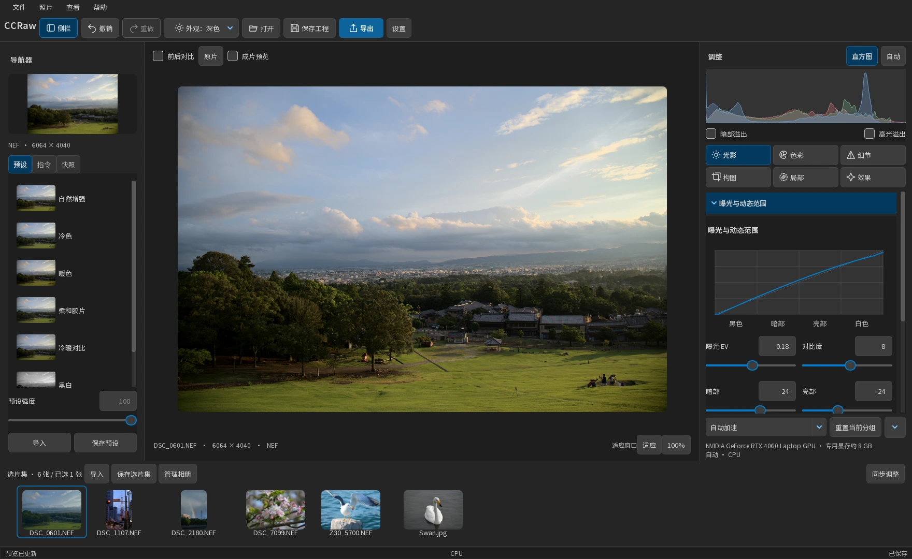

*照片、选片集与六类调整工具放在同一视图中。本文使用软件运行截图；主题、所选工具和服务配置会影响实际显示。*

## 产品概览

CCRaw 围绕照片从导入到交付的连续步骤设计：

| 你要完成的工作 | CCRaw 提供的方式 |
|---|---|
| 从一组照片中选出成片 | 评级、保留 / 拒绝、颜色标签、双图比较、多图筛选和连拍堆栈 |
| 精细调整单张照片 | RAW 显影、曲线、HSL、色彩分级、点颜色、局部蒙版、镜头与透视校正 |
| 统一一组照片的风格 | 预设、快照、虚拟副本、按参数组同步调整和批量导出 |
| 整理持续增长的本地图库 | 多相册、文件夹、智能相册、保存筛选、元数据、离线代理和缺失原片重关联 |
| 用描述找图或准备修图方案 | Photo Agent 的本地分析、混合检索、模型对话与前后效果预览 |
| 为展示和交付制作一致版式 | 拍摄参数、品牌 Logo、字体与留白可调的模板水印 |
| 基于照片继续创作 | 创意模板、风格化或自定义提示词生成，结果独立保存后继续编辑 |

你可以只用照片编辑与相册功能，也可以按需要接入本地模型和外部 AI 服务。基础调色、选片与导出不要求云端账号。

[专业编辑](#专业照片编辑) · [选片管理](#选片与相册管理) · [Photo Agent](#photo-agent) · [模板水印](#模板水印与成片交付) · [AI 创作](#ai-图像创作) · [常见问题](#常见问题)

### 适合怎样的使用场景

- **一次拍摄后的整理与交付：** 导入照片，比较相近画面，标记保留项，完成调色，再套用一致的水印和导出预设。
- **单张照片的精修：** 从曝光与白平衡开始，用曲线、点颜色和局部蒙版逐步修饰，在 100% 视图检查细节。
- **持续积累的个人图库：** 用相册、关键词和智能规则组织照片，借助自然语言寻找记得内容、却记不起文件名的画面。
- **同一张照片的多种表达：** 用快照和虚拟副本保留不同方案，或从当前成片继续生成插画、胶片、微缩场景等创意版本。

## 两种工作空间

启动后，根据这次工作的规模选择入口。两种模式共用照片处理能力，调整可以在 Agent 与完整编辑器之间衔接。

| 入口 | 适合的任务 | 工作方式 |
|---|---|---|
| **快捷编辑** | 直接处理一张照片或一组选片 | 打开原片，使用完整编辑器；按需保存照片工程和选片集 |
| **Photo Agent 新建工程** | 为一次拍摄或一个主题建立项目 | 导入、扫描分析，在图库与对话之间完成整理、检索和方案选择 |
| **打开 Agent 工程** | 继续已有项目 | 恢复工程中的照片、调整、整理建议、会话与执行记录 |

启动页右侧按最近打开时间显示 Agent 工程，可搜索名称或路径，单击继续工作。主界面、Agent 和编辑器均提供外观与设置入口。

<details>
<summary>查看工程启动页</summary>

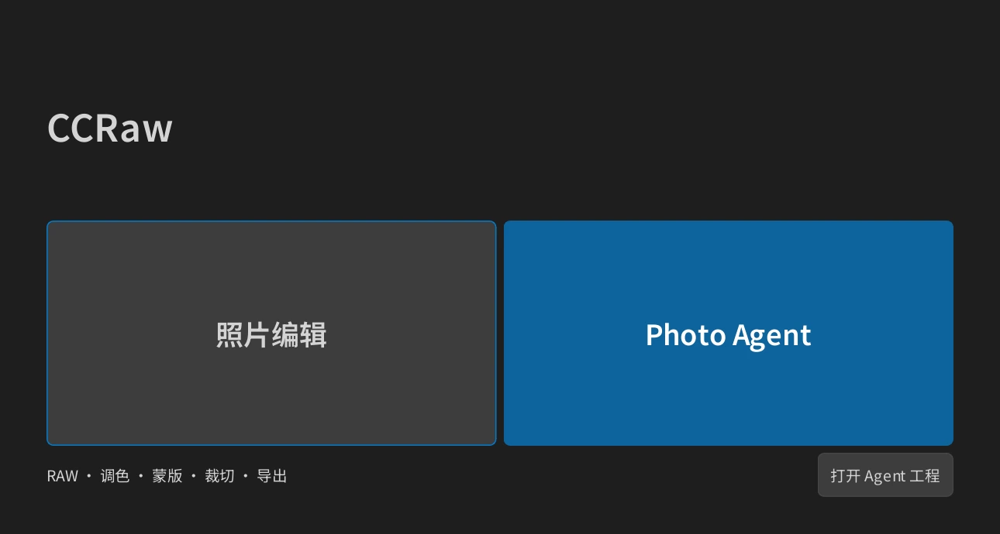

</details>

## 专业照片编辑

### 让每一步调整都看得见

拖动滑杆、移动曲线控制点、调整色彩分级色轮或修改蒙版时，画面随参数更新。适应窗口用于判断整体构图与色调，100% 视图用于检查可见区域的原片像素；「原片」和「前后对比」帮助你判断调整是否合适。

连续输入会合并处理，优先计算最新参数，并复用解码、曲线与滤波缓存。预览最高按 60 Hz 调度，拖动时保留当前预览分辨率；实际刷新率由照片尺寸、工具组合与硬件决定，并非所有原图与操作都固定达到 60 fps。

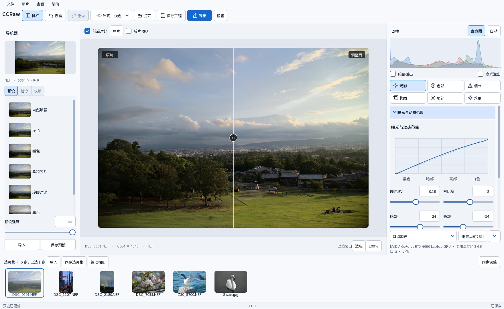

*示例：用 `DSC_0601.NEF` 调整曝光、暗部和亮部，在浅色界面中同时查看原片与当前效果。*

### 六个栏目，按修图目的寻找工具

| 栏目 | 主要功能 | 典型用途 |
|---|---|---|
| **光影** | 曝光、对比度、暗部、亮部、黑白场、曝光曲线、RGB 与独立通道曲线 | 建立亮度关系，整理高光与阴影，控制对比和通道色调 |
| **色彩** | 白平衡、HSL、三段色彩分级、八色黑白混色、点颜色、RGB 校准、LUT / ICC / DCP | 校正偏色，处理特定颜色，制作黑白与个性化色调 |
| **细节** | 清晰度、纹理、常规与精细锐化、亮度与颜色降噪、可选 AI 细节处理 | 在细节、噪点与质感之间取得平衡 |
| **构图** | 裁切、旋转、拉直、镜头畸变、光学暗角、横向色差、透视、缩放与翻转 | 调整取景、校正建筑线条和镜头造成的几何问题 |
| **局部** | 几何与画笔蒙版、颜色 / 亮度范围、组合蒙版、可选自动选区、修复、仿制与红眼 | 分区调整画面，处理局部瑕疵 |
| **效果** | 暗角、胶片颗粒、模板水印与留白 | 完成风格处理与展示版式 |

同类参数放在可折叠分组中。你可以重置当前分组，也可以通过重置按钮旁的菜单恢复整张照片的全部调整，两种操作都支持撤销。

- **裁切框可以移动。** 画好裁切框后，在框内拖动调整取景，保持框的尺寸；点击「确认裁切」或按 Enter 应用。
- **颜色可以直接取样。** 点颜色支持最多 16 个原片颜色样本，分别调整色相、饱和度、明度、范围和羽化，并显示选区。
- **黑白可以按画面调整。** 八色混色提供自动起点，也支持在照片上拖动对应色带。
- **蒙版可以组合。** 对几何、画笔、颜色、亮度和 AI 蒙版执行添加、减去与交集，修改顺序、反相和不透明度；组合对话框确认后作为一次操作撤销，取消会恢复原状态。

<details>
<summary>查看实际操作：曲线、色彩分级与 HSL</summary>

**城市夜景 · RGB 曲线**

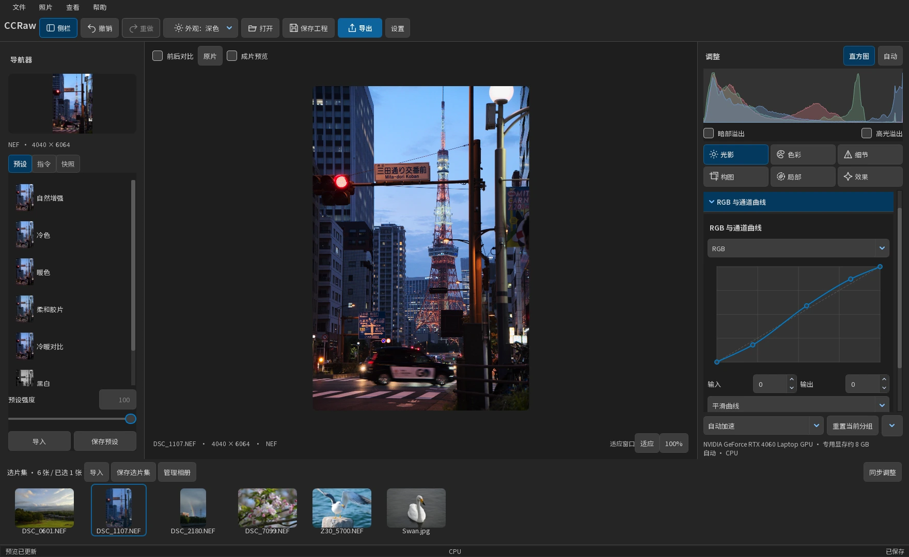

**同一夜景 · 阴影与高光色彩分级**

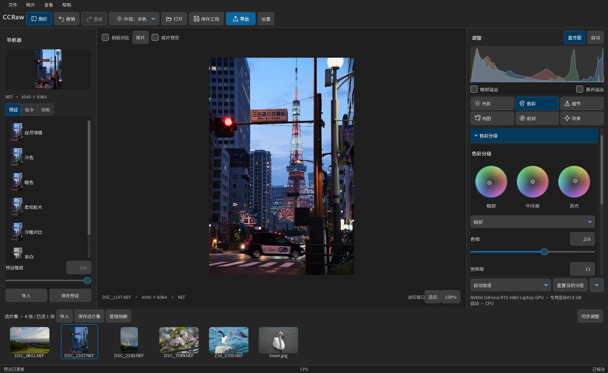

**花朵样片 · HSL 色彩控制**

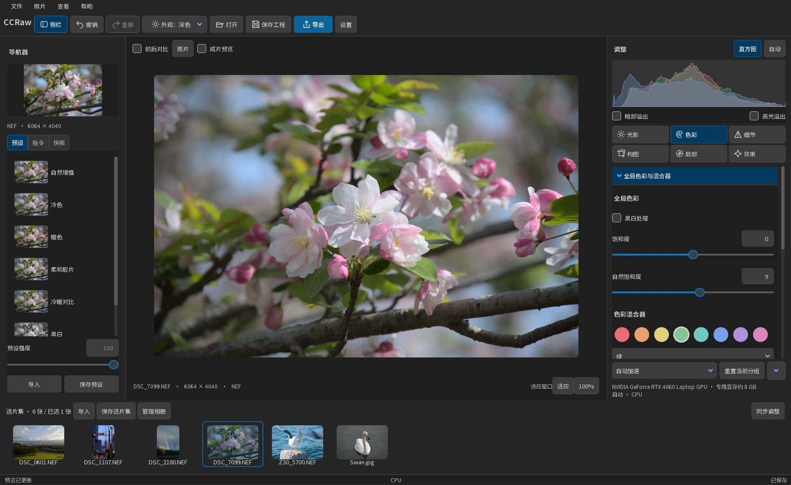

</details>

<details>
<summary>查看实际操作：裁切、局部蒙版与原像素细节</summary>

**天鹅 · 调整裁切取景**

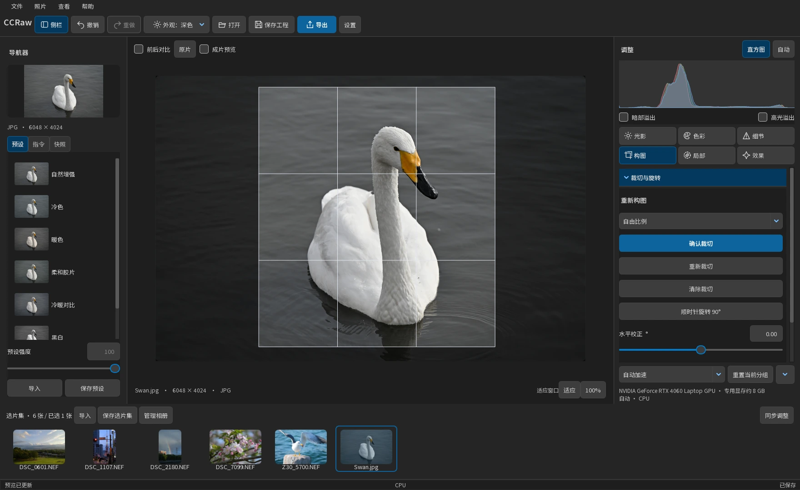

**雨后彩虹 · 径向蒙版与局部调整**

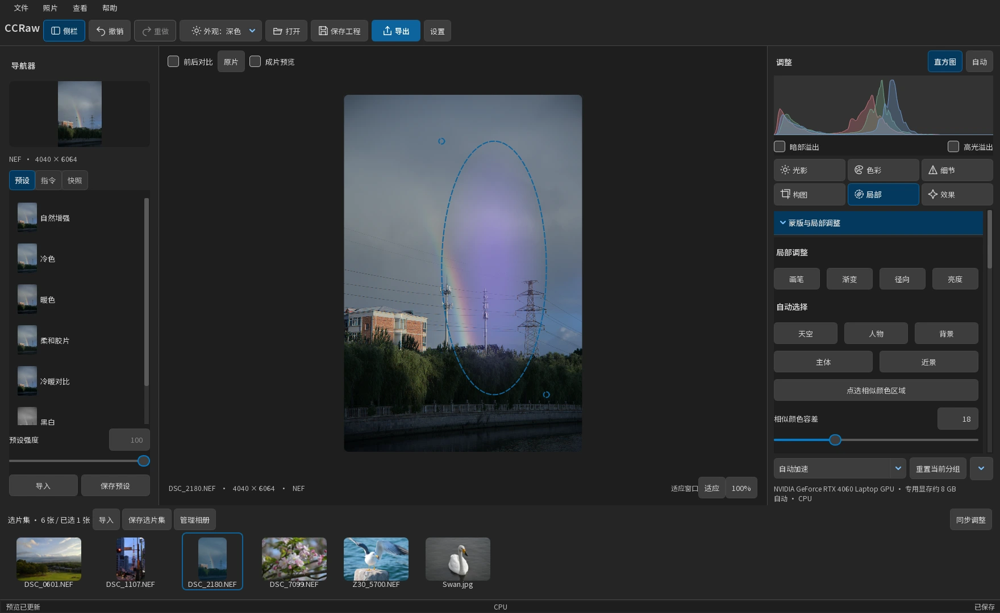

**海鸥 · 适屏查看纹理与锐化**

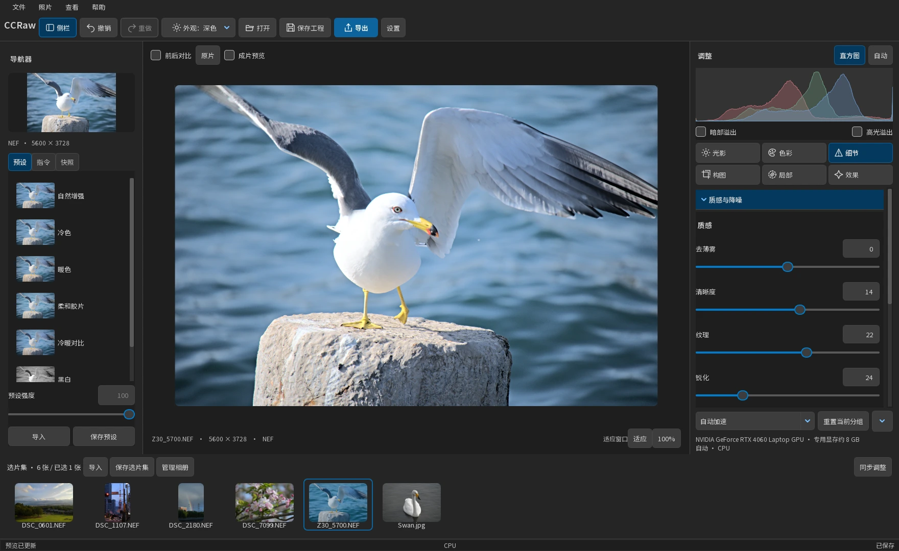

**同一海鸥 · 100% 原像素检查**

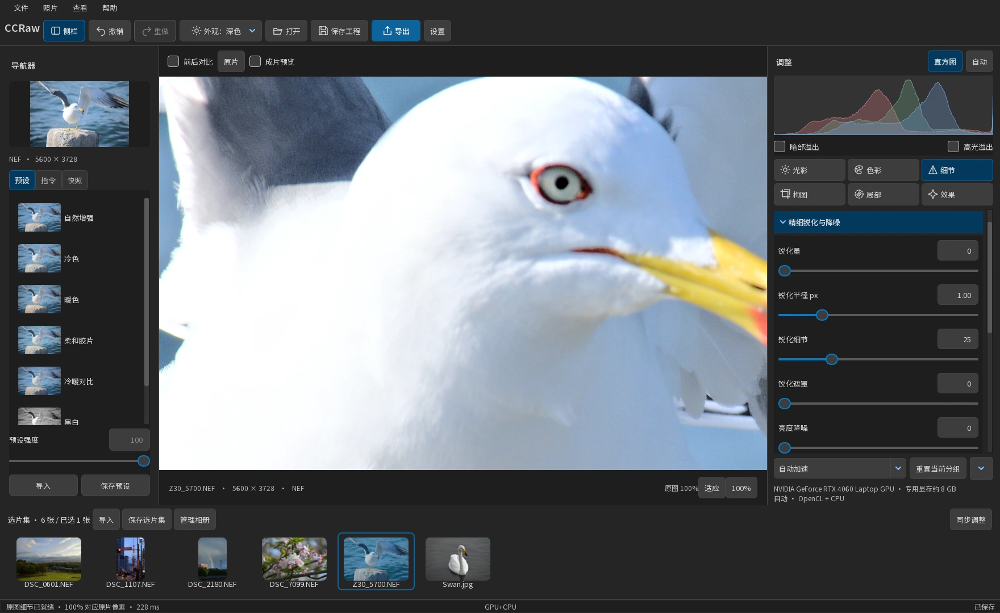

</details>

### 从显影到输出，分别管理颜色

「兼容显影 · sRGB」保留旧工程的显影方式；「宽色域显影 · Rec.2020」使用浮点工作空间，保留中间处理的负值与超白值。支持的 16 位 TIFF、PNG 和 PSD 输入在读取后不先降为 8 位；RAW 仍受机型、编码及 LibRaw 解码能力影响。

显示器 ICC、软打样与导出色域分别设置。导出可选择 **sRGB、Adobe RGB、Display P3、ProPhoto RGB 或 Rec.2020**；软打样提供输出 ICC、渲染意图、黑点补偿、纸墨模拟及色域预警。屏幕预览受显示器和 SDR 显示范围限制。

镜头校正可导入本地 Lensfun XML，配置文件可导入 `.cube`、RGB ICC 或 DCP。软件会说明支持范围；不同编辑器与私有扩展不保证完全相同的外观。详细功能见 [专业编辑](docs/user/editing.md)。

### 多张照片合成一张

在选片集中选择 **2–32 张照片**，从「照片 → 合成」或右键菜单进入合成工作区：

| 方法 | 用途 |
|---|---|
| **景深合成** | 合并不同对焦位置的清晰区域，适合微距或需要更大清晰范围的静态场景 |
| **HDR 堆栈** | 融合不同曝光的画面，提供对齐与去重影选项；采用曝光融合，不生成 HDR 辐射图 |
| **全景合成** | 将具有重叠和可识别细节的照片拼接成更大画幅 |

可以选择参考照片、是否使用当前调整、自动对齐和边缘裁切。先预览，再从原图计算；结果保存为独立的 **16 位线性 DNG** 并加入选片集，原始照片继续保留。明显视差、运动或重叠不足会影响结果。

### 保存编辑，复用风格

工程保存为 `.ccraw`，选片集保存为 `.ccrawalbum`，预设保存为 `.ccrawpreset`。快照用于保留调整过程中的不同方案，虚拟副本用于独立发展不同风格。

对一组照片使用「同步调整」时，可以按参数组选择。默认保留目标照片的白平衡相机基准、裁切、几何、蒙版、修复和水印；需要统一这些内容时再显式选中。每张照片继续维护自己的配方和历史。

## 选片与相册管理

Photo Agent 直接包含图库管理；快捷编辑也可从底部「管理相册」进入同一套功能。评级、整理状态和编辑参数保存在工程中，让选片与修图可以反复往返。

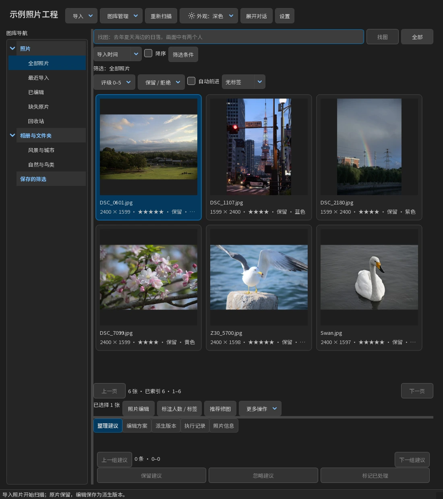

*图库演示使用同组样片经 Photo Engine 导出的 JPEG 副本，展示不同画幅、星级、保留标记和相册归类。*

### 更快地留下值得继续处理的照片

使用 **0–5 星评级、保留 / 拒绝 / 未标记、颜色标签**建立第一轮筛选。方向键连续浏览；开启自动前进后，评级即可切到下一张。常用快捷键为数字 `0–5`、`P / X / U`，输入框获得焦点时仍用于正常文字输入。

双图比较支持同步缩放和平移，并可加载原像素区域检查；多图筛选用于逐步缩小候选范围。管理历史支持撤销与重做，AI 质量提示和你的星级评价分别保存。

<details>
<summary>查看横向与竖向照片的双图比较</summary>

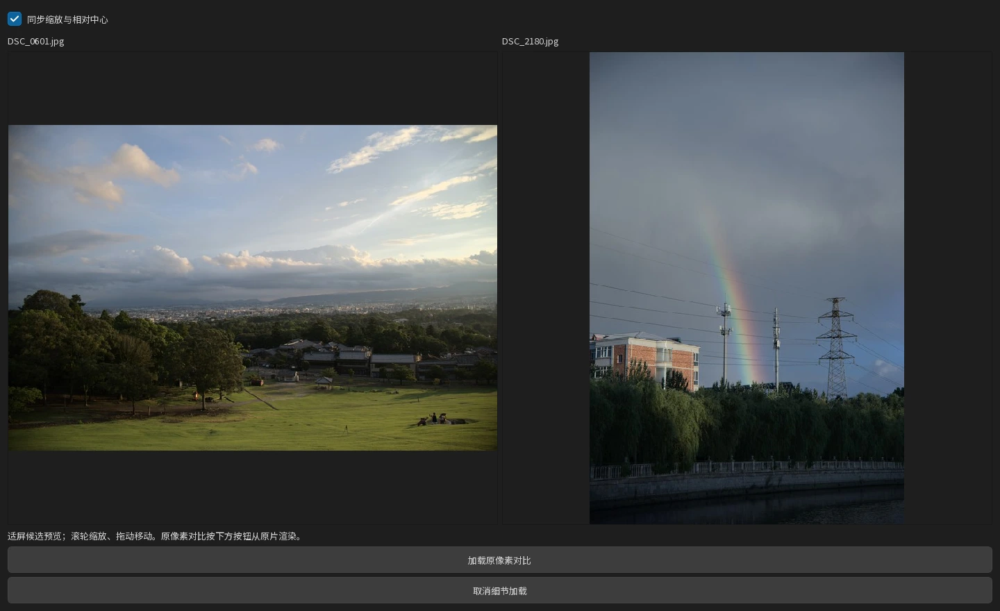

</details>

### 按自己的方式组织图库

| 功能 | 使用方式 |
|---|---|
| 普通相册与文件夹 | 多级文件夹、目标相册、快速集合；同一照片可加入多个相册 |
| 智能相册 | 根据评级、标记、日期、机身、镜头、ISO、格式、关键词和编辑状态动态汇集照片 |
| 保存筛选 | 将常用条件命名保存，更新后继续使用，也可转换为智能相册 |
| 堆栈 | 手动或按拍摄时间分组，设置封面、折叠和展开，配合连拍质量建议选片 |
| 虚拟副本 | 共享原片，分别保存配方与历史，用于比较多种处理风格 |
| 照片信息 | 编辑标题、说明、作者、版权、地点与层级关键词；多选时只批量修改勾选字段 |
| 人物簇管理 | 对匿名人物候选进行合并、拆分与误识别修正 |

原片暂时离线时，可使用带指纹的 **16 位 TIFF 代理**继续编辑；恢复原片后再进行原片导出。缺失文件可重定位与批量重关联。工程回收站管理移除记录，默认不删除磁盘原文件；代理、缓存与原片分别管理。

操作随选择数量和任务状态启用，右键菜单使用同一组动作。高级筛选、排序、代理与回收站的具体操作见 [选片与相册管理](docs/user/catalog.md)。

## Photo Agent

**把一组照片作为一个项目，用对话组织工作，再用可检查的方案完成编辑。**

Agent 共用完整编辑器的 Photo Engine。它读取已导入照片的本地分析结果，将描述转成受约束的工具操作。具体调整可以进入完整编辑器继续修改，并保存回 Agent 工程。

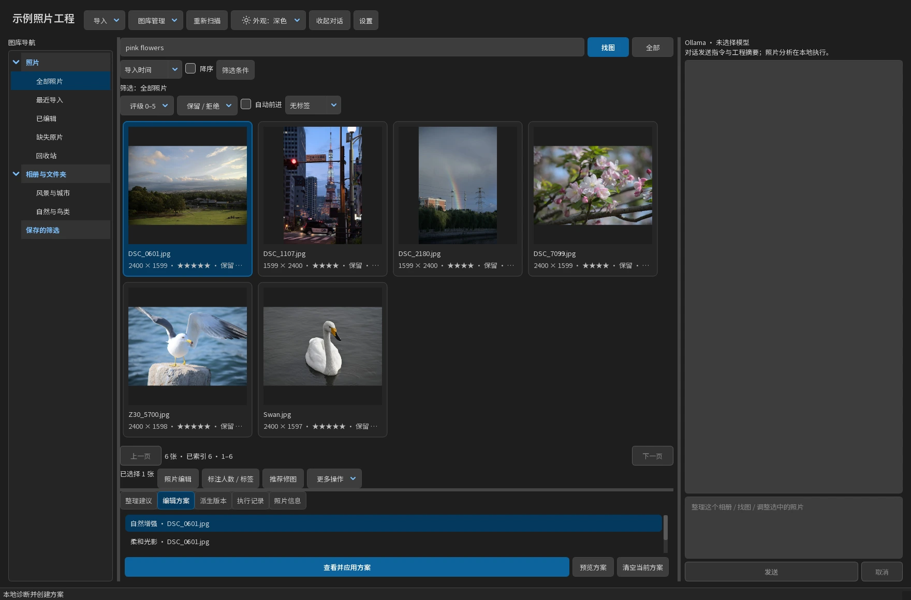

*示例工程导入六张演示副本，使用实际本地分析与推荐生成待选方案；右侧对话区显示尚未配置的模型状态。*

### 扫描、建议、查找、编辑

| 环节 | 可以得到什么 |
|---|---|
| **本地扫描** | 文件指纹、元数据、缩略图、曝光与清晰度信号；安装模型后补充语义及人脸特征 |
| **整理建议** | 完全重复组、相似候选、低质提示、按拍摄时间组织的事件和匿名人物簇 |
| **自然语言找图** | 组合日期、标签、机身等元数据，以及本地语义向量、人物和质量条件 |
| **推荐修图** | 对当前选择进行本地诊断，每张最多三种方案；可继续用自然语言调整 |
| **方案预览** | 比较当前配方与建议配方，可在软件中加载原像素双图检查 |
| **确认执行** | 本地方案从原片生成独立的全分辨率 16 位 TIFF 派生版本，记录来源与历史 |

可以从这些指令开始；日期、内容和照片选择应与当前工程相符：

> 整理当前工程，列出重复照片和清晰度较低的候选。
>
> 找到去年夏天在海边拍摄的日落照片。
>
> 把选中照片的曝光设为 0.3 档，保留每张照片各自的裁切，先预览。
>
> 为当前照片推荐自然增强方案，然后把色调调暖一点。

一次批量调整可覆盖 **1–30 张选中照片**。每张从自己的配方出发，未涉及的参数继续保留；重新推荐会替换对应照片的待选本地方案。当前选择决定方案列表，也可清空待选项，已执行版本与历史保留。

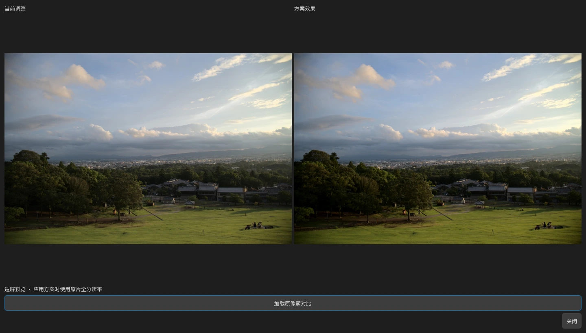

### 模型按需要接入

Agent 默认复用「修图指令」的对话配置，可使用 Ollama、LM Studio 等本地服务，或你配置的云端接口；所选模型必须支持工具调用。语义检索与人物聚类使用 **CLIP、YuNet 和 SFace**，约 **186 MiB**。桌面安装版与便携版已随包提供；源码和 wheel 用户可在「设置 → AI 与服务 → 本地模型」安装。

没有 LLM 时，仍能扫描、查看整理建议、按文件名 / 标签 / 元数据检索，以及使用本地推荐修图。安装语义模型后可使用本地语义检索；复杂中文描述与组合条件更适合通过 Agent 对话转换为查询。

<details>
<summary>查看本地语义搜索：pink flowers</summary>

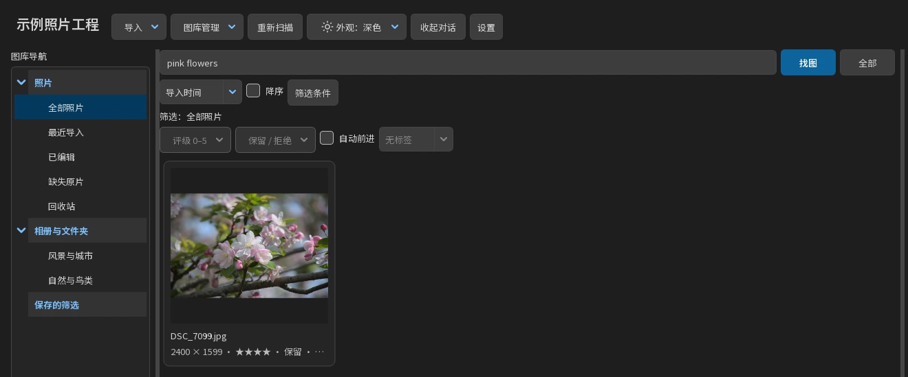

*局部界面截图：使用已安装的本地语义模型查询 `pink flowers`，返回同组照片中的花朵样片。*

</details>

人物簇是匿名候选，需要人工修正；画面人数默认未知，严格人数条件以核验标注为准。相似、低质和事件提示同样是帮助选片的信号，不会自动删除原片。详细边界见 [Photo Agent](docs/user/photo-agent.md)。

### 外部编辑与其他 Agent

外部生成或编辑在执行前展示 Provider、模型、实际上传内容、提示词与费用；费用未知时明确显示未知。聊天工具先准备方案，实际服务请求由界面确认后执行，结果单独保存为派生版本。

支持工具调用的外部 Agent 可通过 **标准 stdio MCP**接入同一套 **17 个照片工具**，查询参数、检索工程、管理相册并创建和预览编辑方案。授权通过项目与照片 ID 指定，实际应用与付费执行继续在软件中确认。连接方式见 [Agent 工具与 MCP](docs/user/agent-tools.md)。

## 模板水印与成片交付

### 把照片、拍摄信息和品牌版式一起安排好

水印使用模板与可组合的处理器，默认 **`standard2`**，提供拍摄参数、圆角、阴影和留白。通过可视化控件调整 `Layout.Type` 与处理步骤，为同组照片建立统一展示格式。

| 模板 | 版式方向 |
|---|---|
| `standard1` / `standard2` | 标准参数水印，搭配机身、镜头、时间与品牌标志 |
| `nikon_blur` / `blur` | 模糊背景与拍摄信息 |
| `normal1` / `normal2` | 右下角参数，或文件夹名称与时间 |
| `center_logo` | 居中 Logo 与四周文字 |
| 旧版 `Layout.Type` 布局 | 左右 Logo、黑红配色、四角文字、1:1 填充、简洁及多种边框 / 模糊组合 |

文字、字体、字号、颜色、Logo、四边留白、间距、对齐、目标比例、模糊、圆角与阴影均可调整，也可添加、删除和移动处理步骤。品牌可自动识别或手动选择，导入的 PNG 可作为标志。实际焦距与 35mm 等效焦距分别保留。

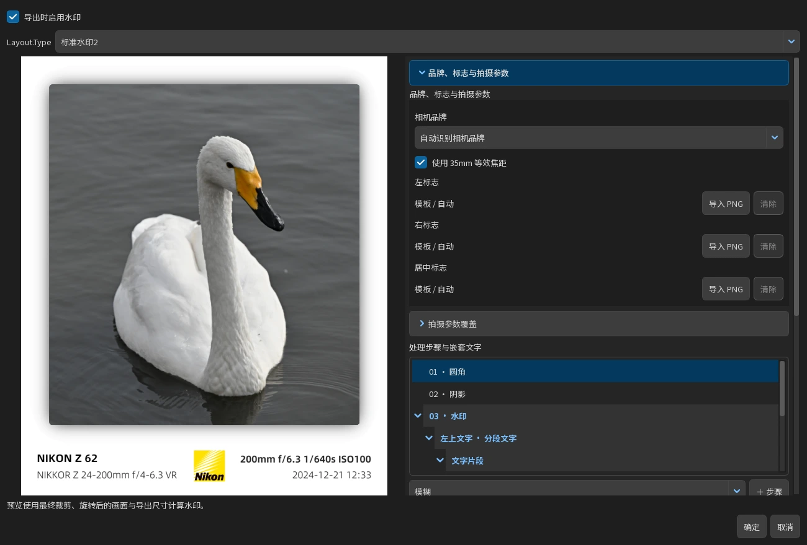

*使用天鹅照片中的 Nikon 机身、镜头、焦距、快门和 ISO 信息，预览 `standard2` 的圆角、阴影与留白。*

<details>
<summary>查看 standard1 模板与裁切结果</summary>

**standard1 模板**

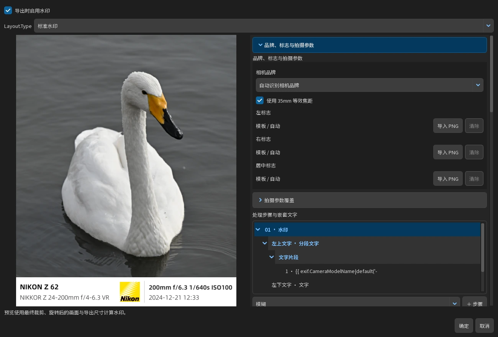

**确认裁切后，返回编辑器继续调整**

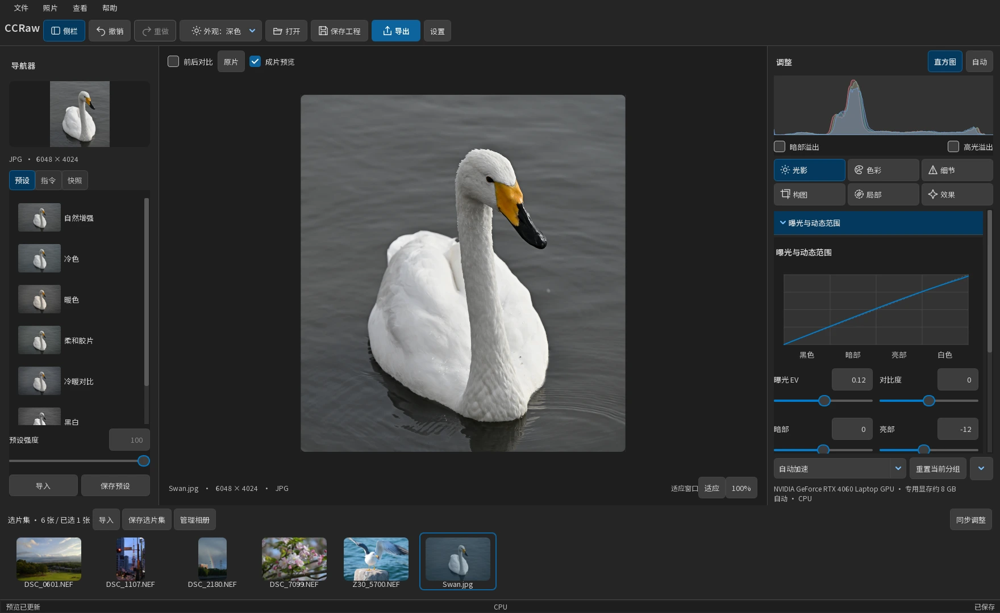

</details>

预览、单张导出、批量导出和外部编辑交接共用配置，布局按最终裁切与旋转后的照片尺寸计算。大尺寸照片的屏幕预览使用缩放网格和超采样，滤镜效果是原分辨率导出的近似显示；完整导出按原尺寸处理。原生普通边框已由模板布局取代，旧配置在读取时迁移。参见 [水印模板](docs/user/watermark.md)。

### 让一组照片按同一规则输出

导出预设可以保存命名方式、同名文件处理、分辨率、尺寸、位深、输出色域、锐化及元数据策略。可移除 GPS 或仅保留版权信息，输出到独立文件。

| 输出与交换方式 | 适合的用途 |
|---|---|
| JPEG | 日常展示与分享，8 位输出 |
| TIFF / PNG | 8 / 16 位交付与后续处理 |
| 合并 RGB PSD | 与支持 PSD 的软件交换像素结果；不生成图层、智能对象或 PSB |
| 外部编辑副本 | 通过独立 TIFF / PSD 交接到配置的编辑器，回传后作为新版本导入 |
| XMP | 交换标准元数据与支持的编辑字段，并保存 CCRaw 完整配方 |

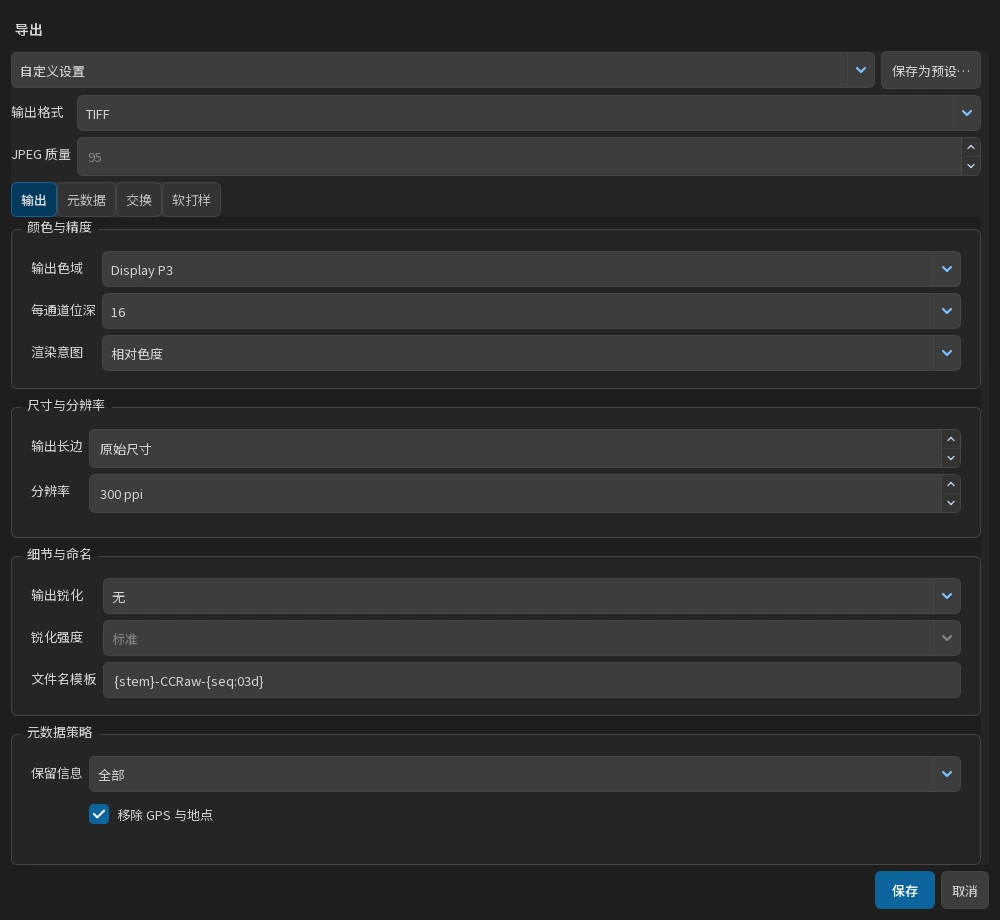

*示例：将交付设置为 16 位 TIFF 与 Display P3，按规则命名，并选择移除 GPS 与地点。*

跨软件的编辑字段和算法存在差异，XMP 交换不保证在所有编辑器中得到逐像素相同的外观。

## AI 图像创作

「指令」中的生成工作流支持文生图和图生图。可以使用当前照片作为参考，也可以只输入文字；生成结果独立保存，随后可打开继续编辑。

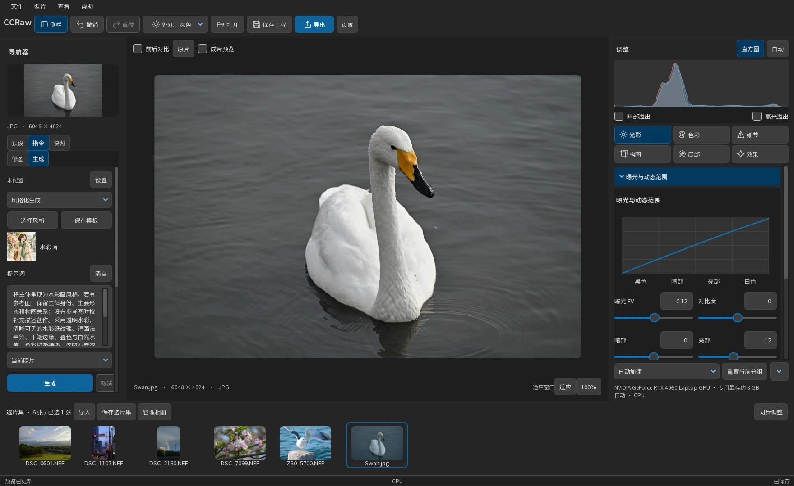

*示例：选择当前天鹅照片作为参考，准备水彩风格生成任务。*

| 模式 | 起点 | 示例方向 |
|---|---|---|
| **创意模板生成** | 50 个内置主题 | 贴纸、拍照亭、Y2K、3D 头像、羊毛毡微缩模型、黏土动画、漫画、蓝图海报等 |
| **风格化生成** | 31 种风格 | 人像、电影、中国风、动漫、水墨、油画、水彩、像素及艺术家风格等 |
| **自定义生成** | 你自己的提示词 | 自行定义主体、场景、材质、构图与光线，配置参考图和生成参数 |

模板支持分类、搜索和主题预览，选中后仍可修改提示词、保存个人模板；「清空」重置当前模式的选择和提示词。主题图片展示风格方向，实际结果由参考图、提示词和所配置的模型共同决定。

<details>
<summary>查看创意主题与风格浏览器</summary>

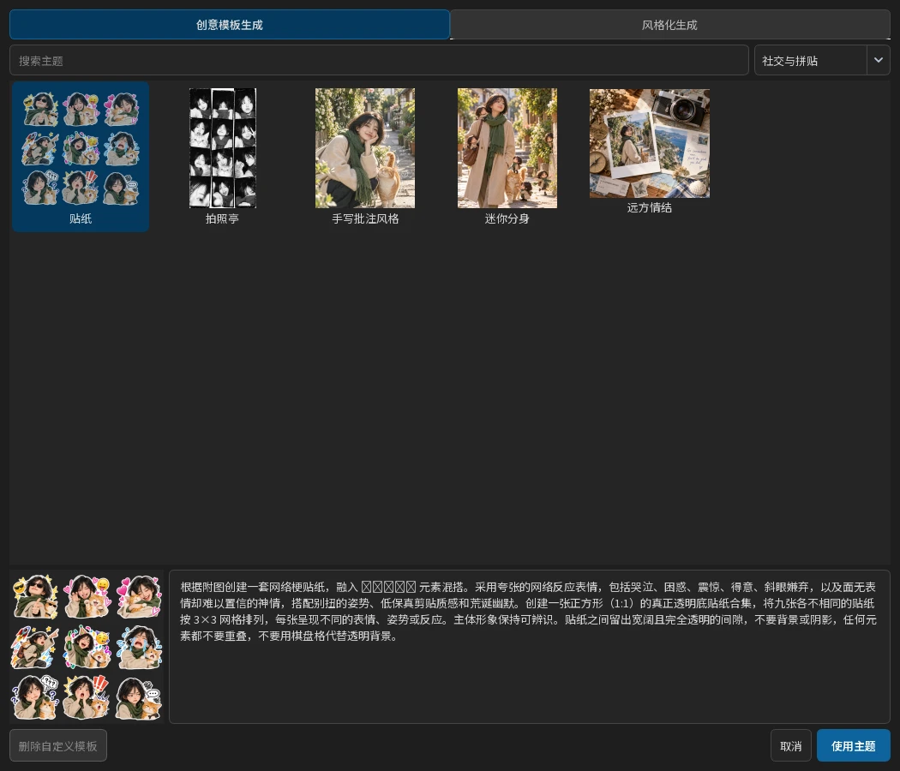

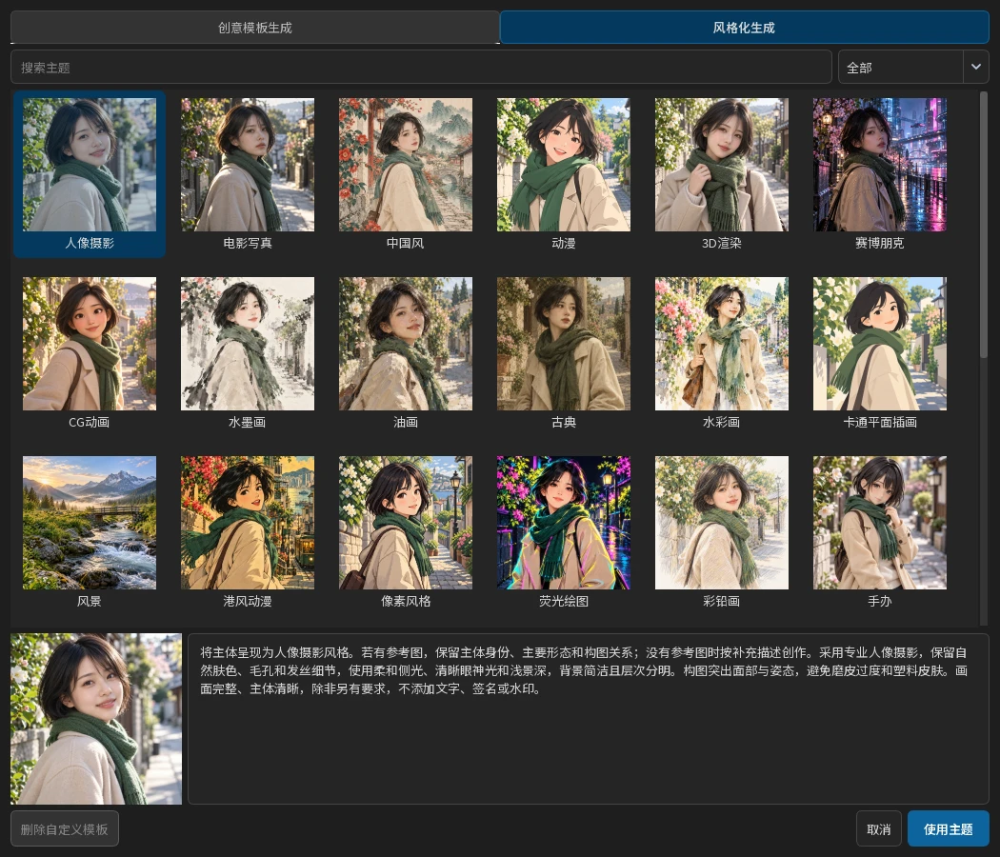

</details>

每张参考图可生成 **1–4 张结果**，队列最多 **32 张**。任务与结果记录可在下次启动后查看，已中断请求不会自动重发。可选 SenseVoice 模型支持本地语音转文字，再将文字交给修图工作流。

图像生成使用独立配置的 Seedream 或兼容服务，和对话模型分别设置。只有勾选「发送参考图」时才发送处理后的参考图；取消已经提交的请求可能仍产生服务商费用。

## 日常体验与自动加速

浅色、VS Code 风格深灰及跟随 Windows 系统的外观可在不同工作区切换；中英文界面与应用设置同步到已打开窗口。主题变化只改变 UI，不修改照片参数或输出颜色。

设置按工作区、照片与色彩、性能与存储、AI 与服务、工作流、保存与恢复分成两级目录。全局默认值与工程覆盖分别保存，后台任务、缓存清理、自动保存、备份及恢复各有对应入口。设置快捷键为 `Ctrl+,`。

选择「自动加速」后，软件按图像大小、工具与缓存状态选择路径：适合的清晰度、纹理与锐化可合并在 OpenCL 上执行，大半径单通道高斯滤镜也可加速；小图和已有缓存保留 CPU 快速路径。DirectML / CUDA 像素计算及模型推理取决于安装的运行环境。

编辑器显示 GPU 型号、专用显存与当前执行路径；「设置 → 性能与存储 → 计算」提供驱动、可用后端和实际执行步骤。检测到显卡不等于所有处理都在 GPU 上完成，手动 CPU 模式可用于选择和排查照片计算路径。参见 [系统设置](docs/user/settings.md)。

<details>
<summary>查看计算设备与 GPU 信息</summary>

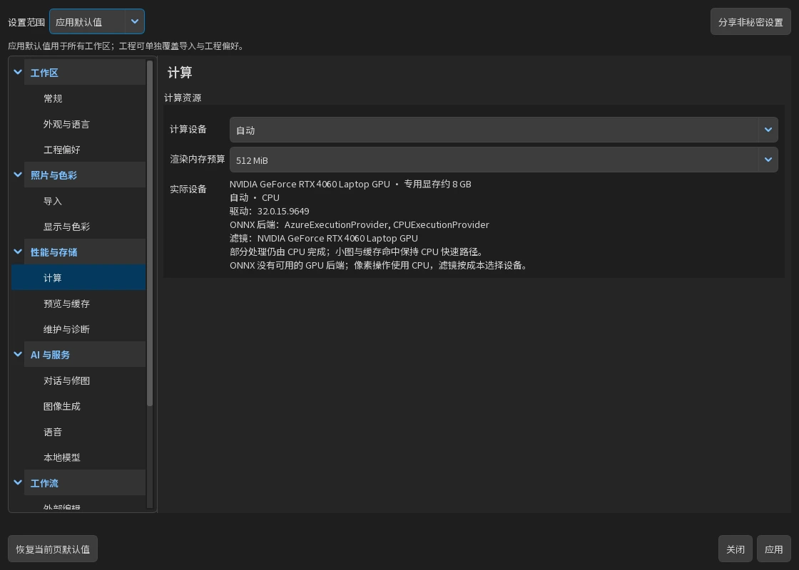

</details>

## 安装与启动

### 运行环境

| 项目 | 当前支持 |
|---|---|
| 桌面系统 | Windows 64 位；当前及后续发行聚焦 Windows |
| Python | 推荐 3.12 64 位；包声明支持 3.12–3.13 |
| 基础编辑 | CPU 可运行，自动加速按驱动与运行环境启用 |
| Photo Agent 对话 | 可选 Agent 依赖，以及支持工具调用的模型服务 |
| 语义检索与人物聚类 | 桌面发行包已包含本地模型；源码和 wheel 可单独安装 |
| AI 生成 | 单独配置的兼容服务及其访问凭据 |

### 方式一：Windows 安装版或便携版

从 [v1.2.1 Release](https://github.com/wamellia/CCRaw/releases/tag/v1.2.1) 下载：

- **安装版：** `CCRaw-1.2.1-Setup.exe`，运行后按向导安装，可创建快捷方式。
- **便携版：** `CCRaw-1.2.1-Windows.zip`，完整解压后打开 `CCRaw-Windows/CCRaw.exe`。保留同目录下的 `_internal` 文件夹。

两种桌面发行物均包含 Python 运行时、照片编辑资源和本地 Agent 模型，无需另装 Python。在线对话和图像生成需要在软件设置中配置自己的服务。工程、设置和下载缓存按用户目录保存。

### 方式二：从源码启动

下载源码，或使用 Git：

```powershell
git clone https://github.com/wamellia/CCRaw.git
cd CCRaw
py -3.12 -m venv .venv
.\.venv\Scripts\python.exe -m pip install -r requirements/base.txt
.\.venv\Scripts\python.exe main.py
```

已有开发环境时，在项目目录直接运行最后一条启动命令即可，也可双击 `run-source.cmd`。

需要 Agent 对话或 MCP 时，在同一环境增加可选依赖：

```powershell
.\.venv\Scripts\python.exe -m pip install -r requirements/agent.txt
```

### 方式三：安装 Python 发布包

[v1.2.1 Release](https://github.com/wamellia/CCRaw/releases/tag/v1.2.1) 提供 `ccraw-1.2.1-py3-none-win_amd64.whl`、源码包及校验文件。将路径替换为 wheel 的下载位置：

```powershell
py -3.12 -m venv .venv
.\.venv\Scripts\python.exe -m pip install "C:\Downloads\ccraw-1.2.1-py3-none-win_amd64.whl"
.\.venv\Scripts\ccraw.exe
```

wheel 安装后的 `ccraw.exe` 是虚拟环境中的启动入口，仍依赖该 Python 环境。希望直接运行桌面程序时，请选择安装版或便携版。

wheel 用户需要 Agent 时，可在安装包的同时启用可选依赖：

```powershell
.\.venv\Scripts\python.exe -m pip install "C:\Downloads\ccraw-1.2.1-py3-none-win_amd64.whl[agent]"
```

### 按需安装模型与运行资源

| 想启用的能力 | 配置入口 |
|---|---|
| Agent 对话与自然语言修图 | 设置 → AI 与服务 → 对话与修图；填写本地服务或云端接口与模型 |
| 本地语义检索和人物聚类 | 完整桌面版已包含；源码和 wheel 可在设置中下载 |
| AI 细节、自动选区、语音及完整元数据工具等可选能力 | 安装对应运行资源，按模型可用性启用 |
| 图像生成 | 图像生成的设置入口；配置接口地址、模型与 API Key |

大型 AI 模型与 ExifTool 通过独立 [运行资源包](https://github.com/wamellia/CCRaw/releases/tag/runtime-assets) 提供。在源码目录可导入下载的资源包：

```powershell
.\.venv\Scripts\python.exe tools/assets/fetch_assets.py --archive "C:\Downloads\CCRaw-0.1.0-RuntimeAssets.zip"
```

完整离线交付目录已包含对应资源时无需重复安装。Agent 模型与编辑器运行资源分别管理，模型用途及许可见 [模型资源](docs/user/models.md)。

### 可选 GPU 环境

默认安装提供 CPU 后端，驱动与 OpenCV 支持 OpenCL 时可直接使用适合的滤镜加速。额外的 Windows GPU 环境见 `requirements/windows-directml.txt`，NVIDIA CUDA 环境见 `requirements/windows-cuda.txt`。

这些文件包含 ONNX Runtime 替换与环境要求；安装前按说明移除冲突的 ONNX Runtime 发行包，每个环境只保留一种。详情见 [Windows 构建与运行环境](docs/development/releasing.md)。

## 跟着样片看编辑流程

本页的新增示例使用五份 NEF 与天鹅照片，分别展示适合该画面的操作。可以按照片名称直接打开对应截图：

| 样片 | 演示内容 |
|---|---|
| `DSC_0601.NEF` · 风景 | [明暗前后对比](docs/screenshots/editor-light.webp)、[Agent 本地方案预览](docs/screenshots/agent-preview.webp) |
| `DSC_1107.NEF` · 城市夜景 | [RGB 曲线](docs/screenshots/workflow-curves.webp)、[色彩分级](docs/screenshots/workflow-grading.webp) |
| `DSC_2180.NEF` · 雨后彩虹 | [径向蒙版与局部调整](docs/screenshots/workflow-local-mask.webp) |
| `DSC_7099.NEF` · 花朵 | [HSL 调整](docs/screenshots/workflow-color.webp)、[本地语义找图](docs/screenshots/workflow-search.webp) |
| `Z30_5700.NEF` · 海鸥 | [细节调整](docs/screenshots/workflow-detail.webp)、[100% 原像素检查](docs/screenshots/workflow-detail-100.webp) |
| 天鹅照片 | [裁切取景](docs/screenshots/workflow-crop.webp)、[模板水印](docs/screenshots/workflow-watermark.webp)、[裁切结果](docs/screenshots/workflow-crop-result.webp) |

图库页面使用同组照片经 Photo Engine 导出的 JPEG 演示副本。仓库保存界面截图，原始 NEF、独立演示 JPEG、工程和缓存保留在本地。图片说明见 [截图与样片说明](docs/screenshots/README.md)。

## 第一次使用，可以这样完成一个项目

1. **建立工作区。** 单张精修选「快捷编辑」，一组拍摄选「Photo Agent 新建工程」并导入照片或文件夹。
2. **完成第一轮筛选。** 标星、标记保留项，对相近画面做双图比较；需要时查看本地整理建议。
3. **先调整一张代表照片。** 依次处理光影、色彩与构图，在 100% 视图检查细节，再做局部修饰。
4. **将风格应用到同组照片。** 保存预设或选择参数组同步；白平衡、裁切、蒙版等是否同步可分别决定。
5. **比较不同版本。** 使用快照、虚拟副本或 Agent 方案预览，确定最终效果。
6. **准备交付。** 选择水印模板、输出色域、尺寸与命名规则，批量导出成片，并保存工程以便继续修改。

## 数据、原片与隐私

原片、编辑参数和派生结果分开管理。工程文件按路径引用原片，备份或搬迁时应同时考虑工程数据与原始照片。

| 文件 / 目录 | 保存的内容 |
|---|---|
| `.ccraw` | 单张照片的编辑工程与配方 |
| `.ccrawalbum` | 传统选片集与对应照片调整 |
| `.ccrawpreset` | 可复用的调整预设 |
| `.ccrawagent` 与同名 `.ccrawagent-data` | Agent 工程清单、数据库、预览、派生版本、会话和执行记录 |

基础照片处理在本地完成，软件不会自动上传照片、日志或遥测。对话根据所选服务发送指令与必要上下文；Agent 使用有限工程摘要和工具结果。编辑器修图指令可按用户选择附加缩小预览。生成服务只在需要时接收提示词和明确选择的处理后参考图，原始 RAW 不作为参考图上传。

API Key 使用 Windows DPAPI 保护，与源码分开保存。人物特征、会话及图像生成记录属于本地项目或用户数据，分享工程前应按用途整理。外部编辑确认和已中断请求的处理方式见 [隐私说明](docs/user/privacy.md)。

## 常见问题

**不配置 AI，还能正常修图吗？**  
可以。RAW 显影、手动调整、曲线、选片、相册、模板水印和常规导出都可独立使用。需要模型或外部服务的能力按需配置。

**为什么选择自动加速，有时仍显示 CPU？**  
自动模式会考虑传输成本和缓存。小图、缓存命中或不支持的操作使用 CPU 可能更快；计算设置会显示实际路径。

**自然语言找图为什么有时只有文件名匹配？**  
语义检索需要本地模型，模型未安装时使用文件名、标签与元数据。复杂中文描述建议通过配置好的 Agent 对话查询。

**“画面有两个人”能作为精确条件吗？**  
严格人数条件使用人工核验标注，默认未知人数不会作为严格匹配。人物检测与匿名聚类是辅助信号。

**编辑器预览、Agent 预览和导出有什么区别？**  
编辑器支持原像素区域检查；Agent 常规前后预览是有尺寸上限的 8 位 JPEG，也可在软件中加载原像素比较。最终本地方案从原片生成，常规导出按所选尺寸、位深与色域执行。

**水印字体或镜头配置没有生效怎么办？**  
确认字体、Logo 与配置文件仍可访问，并查看对应支持范围。上游缺失的特定字体沿用回退；外部 ICC、DCP 和镜头 XML 需要随工作环境保留。

## 文档与参与

完整导航见[文档索引](docs/README.md)。使用指南位于 `docs/user/`，开发与构建说明位于 `docs/development/`。

| 想了解的内容 | 文档 |
|---|---|
| 专业参数、颜色、蒙版与输出边界 | [专业编辑](docs/user/editing.md) |
| 选片、相册、筛选、代理与文件管理 | [选片与相册管理](docs/user/catalog.md) |
| Agent 工程、模型、找图与执行流程 | [Photo Agent](docs/user/photo-agent.md) |
| 对话工具、可调参数与 MCP 连接 | [Agent 工具与 MCP](docs/user/agent-tools.md) |
| 模板水印、布局与素材来源 | [水印模板](docs/user/watermark.md) |
| 全局设置、缓存、任务与恢复 | [系统设置](docs/user/settings.md) |
| 模型下载、用途与许可 | [模型资源](docs/user/models.md) |
| 数据发送和本地信息保护 | [隐私说明](docs/user/privacy.md) |
| 二次开发、结构与打包 | [贡献说明](CONTRIBUTING.md) · [模块结构](docs/development/architecture.md) · [Windows 构建](docs/development/releasing.md) |

欢迎通过 [GitHub Issues](https://github.com/wamellia/CCRaw/issues) 反馈可复现的问题、操作体验和功能建议；代码贡献可从贡献说明开始。提交问题时提供软件版本、Windows 环境与复现步骤，分享日志和照片前先检查私人信息。

## 仓库目录

| 目录 | 内容 |
|---|---|
| `ccraw/` | 应用源码；图像、配方、相册、Agent、界面与资源按领域组织 |
| `requirements/` | 基础、Agent、开发及可选 Windows GPU 依赖环境 |
| `tools/` | 按 assets、models、packaging、benchmarks、diagnostics、release 分类的维护工具 |
| `tests/` | 功能、兼容性与运行资源测试 |
| `docs/` | 使用指南、开发说明和界面截图 |
| `assets/` | 可选运行资源清单、模型元数据及许可 |

源码入口为 `main.py` 和 `run-source.cmd`；构建与发布入口为 `build.ps1`、`build-release.cmd` 和 `publish-release.cmd`。公共 `ccraw.model`、`ccraw.engine` 导入与工程配方保持兼容，源码职责见[架构](docs/development/architecture.md)。

## 开源与致谢

CCRaw 由 CCRaw contributors 持续开发与维护，项目源码采用 **MIT** 许可，详见 [LICENSE](LICENSE)。

感谢 Python、Qt / PySide、NumPy、OpenCV、LibRaw、LittleCMS，以及为图像处理、模型推理、字体和开发工具提供基础能力的开源社区。组件在软件中的用途、官方来源、版本与许可分类见 [THIRD_PARTY.md](THIRD_PARTY.md)。

随附第三方组件、模型、字体与素材保留各自条款，许可文件随对应资源保存，详见 [THIRD_PARTY.md](THIRD_PARTY.md)。
