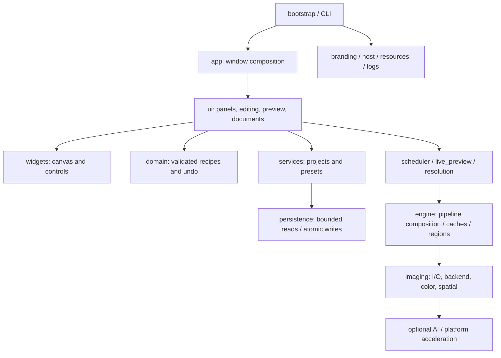

# Architecture

Windows Qt desktop application. `app` composes document, preview, adjustment, workspace and platform services. Image processing supports CPU, DirectML and optional CUDA; model sessions can also use TensorRT.

The public model and engine modules are stable facades. Recipe version 6 adds neutral professional controls and an explicit process selector: process 1 preserves legacy sRGB development, while process 2 carries signed floating-point Rec.2020 values through color, grading and local adjustments. Output conversion precedes quantization. The image pipeline retains dynamic public hooks used by optional backends and tests. Pixel operators use float32 analytical formulas; curves retain their float64 interpolation. Native parallel kernels disable fastmath and use bounded threads.

`domain/professional.py` validates optical, geometric, calibration, detail, point-color, profile, monochrome and red-eye controls. `imaging/professional.py` shares composed geometry maps with canvas coordinates, crop constraints and masks; neighborhood margins keep local rendering consistent with full-frame evaluation. `domain/sync.py` defines explicit synchronization groups. `imaging/colorspaces.py`, `cms.py`, `profiles.py` and `display.py` separate input interpretation, working colors, output ICC and display-only proofing. Bundled LittleCMS provides float and uint16 transforms without an 8-bit bridge. Unsupported DCP/Lensfun fields are reported rather than treated as applied.

Preview input is coalesced. The GUI owns edit state and QPixmap; the single image worker owns immutable snapshots, image processing, histogram/overlay preparation and QImage conversion. Epoch and document tokens reject incompatible old results. Fit view keeps the standard preview resolution; zoomed rendering evaluates visible original-pixel regions with neighborhood margins and global effect coordinates.

Point-color gestures cache the pre-professional input, calibrated Oklab source and selection coverage within the existing render budget. Keys include upstream parameters and all selection ranges; changing hue/saturation/luminance reuses coverage, while input or range changes invalidate it. Only covered pixels pass through the color round trip, and uncovered pixels remain exact. Named-space transfers and matrices use bounded native CPU kernels with float64 reference arithmetic rounded to float32; the NumPy path remains available when native compilation is unavailable.

Interactive scheduling targets 60 Hz and keeps one pending recipe, not a queue of slider events. A frame cancellation check runs between pipeline stages and streamed blocks. It expires on a changed gesture epoch, document or closing/loading state, not every newer parameter value: continuous drags can still present completed frames. Original-pixel regions use the same checks. Composite-mask dialogs preview copied component lists inside one transaction and restore the original recipe on cancellation.

Straightening updates the presentation flag without synchronously rotating or converting pixels in its GUI callback; the render snapshot owns that work. Optical vignetting retains a reusable linear input and double-precision radial field, then fuses its double gain/transfer arithmetic into a bounded native loop. Decoder-cache budget changes, clears and insertions share a lock; an epoch prevents a decode already in progress from repopulating the cleared cache, without locking file I/O or image processing.

Stage keys separate spatial optics, color controls and final geometry. Perspective/flip/distortion changes reuse developed colors and detail stages. Shared-channel geometry uses one inverse map and one RGB remap when chromatic aberration is neutral. Native maps preserve the NumPy operation's float32/double boundaries and validate projective horizons and radial folds. Lensfun's imported models keep their existing mathematical path. Spatial amount drags retain the noise result and clarity/texture/sharpen bands; professional detail controls retain their Oklab input and fixed-radius bands. HSL, black-and-white, point-range overlays, LUT/ICC strength and DCP camera/look intensity have separate pre-edit input caches. DCP strength changes blend a calibrated input instead of decoding the RAW again.

Wide curves evaluate the original piecewise linear or monotone cubic polynomial directly in native loops, including extended endpoint behavior; legacy smooth curves retain the same 4097 knots. Signed named-space conversion, saturation, tonal range fields, grading, HSL parameters and display quantization fuse per-pixel arithmetic with fastmath disabled. Oklab matrices and cube/cube-root functions retain their original NumPy arithmetic. Large contiguous cube/cube-root arrays use eight aligned disjoint NumPy ufunc blocks, rather than replacing the functions with a numerical approximation.

OpenCV, NumExpr and native pixel kernels use at most eight compute threads. `threadpoolctl` also limits an already-loaded BLAS pool to one thread: 3x3 RGB matrices do not benefit from a large competing BLAS pool. Native warm-up is split into idle jobs so foreground photo reads and previews can run between kernels. ICC decode tiles have independent native transforms and use the same bounded pool as NumPy ufunc blocks; no CMS handle is shared. Large raster previews decode and area-average linear samples in bounded strips, retaining 16-bit input and ICC interpretation. A per-editor decoded-input LRU uses file path, timestamp, size and preview limit, and shares no mutable metadata with callers. Its budget is at most 96 MiB and one quarter of the render-memory setting; clearing memory preferences clears it too. Thumbnails yield between individual photos at lower priority than foreground loading.

Resource resolution supports CCRAW_ASSET_DIR, frozen bundled assets, source assets and installed package resources. CCRAW_DATA_DIR / CCRAW_CACHE_DIR allow independent deployment and tests. Windows defaults use `%LOCALAPPDATA%/CCRaw` for application data and its `cache` and `logs` subfolders.

Project, preset and album saves use same-directory temporary files and atomic replacement. Existing files survive a failed replacement. Legacy identifiers/extensions are read explicitly; new writes use CCRaw identifiers without changing the validated recipe schema solely for branding.

Feature-specific modules retain image stacking, selection, restoration, speech and optional model services. They remain optional computations behind the same scheduler and CPU fallback rather than a new network dependency for normal editing.

`photo_agent/ui.py` adds a launcher and a separate project workspace without changing the catalog window composition. A cancellable Qt worker owns each Agent job; GUI state and QPixmap remain on the GUI thread. The editor bridge restores validated per-photo recipes and explicitly saves them back into the Agent project.

`photo_agent/store.py` owns SQLite transactions and portable project manifests. Photo facts, preferences, messages, jobs and runtime events use separate tables. `catalog/repository.py` adds transactional management commands, persistent undo/redo, ratings, flags, albums, filters, stacks, virtual copies, metadata overrides, relinking, proxies and project trash. `catalog/rules.py` compiles bounded allowlisted query trees to parameterized SQL before stable pagination. Copies share source facts but retain independent recipes and histories. `catalog/manager.py` bridges classic editor documents, including relinked paths and metadata. `analysis.py` implements incremental scan → analysis → index, preserves checkpoints and records human suggestion/person-cluster corrections separately; `search.py` validates allowlisted metadata constraints before bounded hybrid ranking. `models.py` loads verified local CLIP and face models lazily. This maps DeepTutor's ingestion/retrieval abstraction to photos without importing its teaching business or runtime.

`runtime.py` hosts nanobot-ai 0.3.5's existing AgentLoop, Request Context, Runtime Context Provider, hooks and events. It replaces default tool registration with a photo-only registry, preserves the upstream loop, and supplies bounded project context. `plugins.py` separates declarative capabilities from tools and checks ownership during registration, applying the explicit plugin composition idea from deepseek-harness without adding its TypeScript runtime. Shell, web, file, subagent and payment execution tools are not registered.

`editing.py` separates editable proposals from execution. Local edits use the existing full-resolution engine; external proposals freeze the JPEG reference and hash provider settings, disclosure and source. Only the GUI invokes execution after confirmation. Atomic single-use claims, restart interruption and independently recorded derived files prevent automatic paid replay.

`photo_agent/controls.py` defines a bounded edit patch schema using the existing natural-language parameter ranges and validated recipe model. Unknown fields and incompatible mask geometry fail before proposals are stored. `get_edit_controls` exposes section schemas and saved values; schemas remain complete when large current-state arrays are truncated at the model context boundary. This contract covers Agent-facing controls; the editor's sliders still use their existing document and undo flow.

Batch proposals validate all targets before one SQLite transaction replaces pending proposals for 1–30 selected photos. Each target starts from its own saved recipe. `preview_local` uses the same Photo Engine at a bounded fit-view resolution, shares a RenderCache between the before/after renders, scales detail radii relative to the original dimensions, and caches JPEGs by source hash, both recipes and requested size. It validates the original even on a cache hit and rebuilds invalid cached images. Qt workers perform rendering; a palette-aware dialog displays both images with their aspect ratios intact. A preview neither claims a proposal nor creates a derivative.

`photo_agent/mcp_server.py` adapts the same seventeen ToolSpecs to the optional Python MCP SDK over stdio. Eight catalog tools share the same command validation and persistent undo as the UI. It exposes schemas through tools/list and returns text plus two JPEG image blocks for preview_edit. Requests are serialized within one server to bound concurrent render memory. The server is launched from Python source with an explicit project and optional immutable --select photo IDs; photo mutations, edit proposals and previews require that selection. It has no apply/export tool or network listener. The UI remains the approval and derived-version execution boundary. This adopts LightCraft's declarative control/command and image-result ideas without replacing nanobot's loop or importing the Rust engine.

Agent proposal previews and catalog Compare share `catalog/views.py` for original-pixel comparison: immutable per-view recipes, a background decoder, synchronized relative centers and bounded visible tile caches. Two views of one source share decoded pixels. The source hash and pending proposal status are checked around native decoding; previews create no derived file.

`generation_panel` adds template browsing and a bounded serial queue under the instruction page. `image_generation` prepares immutable edited references, sends cancellable HTTP requests, validates complete output images, and commits independent results with SQLite task history in per-user storage. Settings snapshots stay in memory; credentials never enter task records. Restart cancels interrupted tasks instead of resubmitting paid requests. Network generation does not occupy the editing scheduler.

`settings.py` owns validated application defaults and allowlisted project overrides. `ui/settings_dialog.py` installs the same preferences entry and subscription in all three workspaces. `recovery.py` serializes debounced saves and recovery sessions, and uses SQLite backup for consistent project backups. `workspace.json` stores window geometry, splitters and stable view IDs independently of photo recipes. `i18n` translates visible text without changing database or control identifiers.

`ui/theme.py` owns light, deep-gray and Windows-system tokens and the Qt palette. Repeated same-theme broadcasts avoid redundant stylesheet application. Custom painters read the current widget palette; theme changes do not modify image recipes or preview pixels. `workspace.py` contains presets, snapshots and grading; `editing_tools.py` contains camera white balance and retouch controls.
