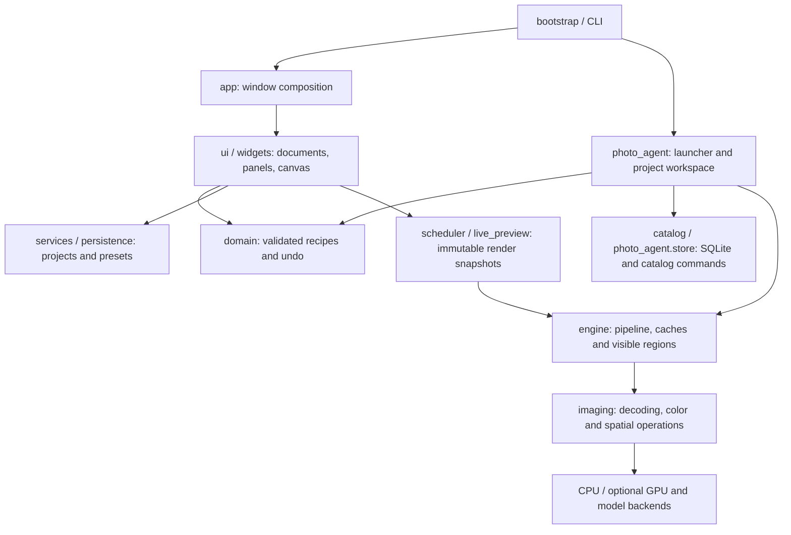

# Architecture

CCRaw is a Windows Qt desktop application. Quick Edit and Photo Agent share validated photo recipes and the same rendering engine. The application keeps originals, editable parameters and derived outputs separate. Start with the [documentation index](../README.md) for user guides or the [contribution guide](../../CONTRIBUTING.md) for development commands.

Repository setup profiles live in [requirements/](../../requirements/README.md), while maintenance commands are grouped by purpose in [tools/](../../tools/README.md).

## Source domains

The `ccraw/` package groups reusable domains into subpackages. Application composition, public entry points and shared feature modules remain directly inside the package so existing imports continue to work.

| Location | Responsibility and entry points |
|---|---|
| [bootstrap.py](../../ccraw/bootstrap.py), [app.py](../../ccraw/app.py) | CLI/desktop startup, worker-process setup and composition of the main editor window |
| [model.py](../../ccraw/model.py), [engine.py](../../ccraw/engine.py) | Public recipe/persistence API and pipeline composition, including render caches, output conversion and region rendering |
| [domain/](../../ccraw/domain/) | Recipe defaults and validation, history, professional controls and explicit synchronization groups |
| [imaging/](../../ccraw/imaging/) | Decoding, backend selection, working/output/display color, profiles, optics and spatial operations |
| [interchange/](../../ccraw/interchange/) | Supported XMP metadata/edit exchange and merged RGB PSD exchange |
| [services/](../../ccraw/services/), [persistence.py](../../ccraw/persistence.py) | Project and preset formats, bounded reads and atomic writes |
| [ui/](../../ccraw/ui/), [widgets/](../../ccraw/widgets/) | Editor panels, document actions, preview coordination, dialogs, theme, canvas and controls |
| [catalog/](../../ccraw/catalog/) | Catalog commands, persistent undo/redo, query rules, classic-editor bridge, management window and comparison views |
| [photo_agent/](../../ccraw/photo_agent/) | Agent project storage, scanning, local models, retrieval, proposals, restricted runtime and stdio MCP |
| [diagnostics/](../../ccraw/diagnostics/) | Desktop smoke, merge, workflow and release checks; `ccraw.diagnostics.run` remains available |
| [i18n/](../../ccraw/i18n/) | Visible Chinese/English text without changing persisted control or database identifiers |
| [resources/](../../ccraw/resources/), [resources.py](../../ccraw/resources.py) | Assets grouped as icons, fonts, generation, watermark, models, native libraries and licenses; shared resource lookup |

Shared modules at package level implement named features. `scheduler.py`, `live_preview.py`, `resolution.py` and `viewport.py` coordinate rendering; `compute.py`, `native_kernels.py`, `gpu_spatial.py`, `tonal_dml.py` and `winml.py` provide acceleration. `merge.py`, `selection.py`, `restoration.py`, `retouch.py` and `speech.py` implement optional photo computations. `watermark*.py` handles templates and processors. `image_generation.py` and `generation_panel.py` handle external generation. `settings.py`, `recovery.py`, `host.py`, `branding.py` and `logs.py` provide shared desktop services.



## Public imports and recipes

`ccraw.model` re-exports the recipe and history API from `domain.recipes` and project/preset functions from `services.projects`. `ccraw.engine` remains the shared entry point for rendering. Existing dynamic engine hooks used by optional backends and tests remain part of that integration.

Recipes are validated dictionaries containing global adjustments, curves, HSL, grading, effects, masks, geometry, professional controls and watermark settings. Version 6 uses an explicit `process` field: `1` preserves legacy sRGB development; `2` uses signed floating-point Rec.2020 through color, grading and local adjustments. Output conversion precedes quantization. Legacy file identifiers/extensions are accepted by the relevant readers; new project writes use CCRaw identifiers.

For example, this creates a validated recipe without reading or changing a photograph:

```python
from ccraw import model

edits = model.recipe()
edits['adjustments']['exposure'] = 0.3
edits = model.validate(edits)
```

`model.save_project(path, source, edits)` stores a source reference and validated parameters; it does not copy the original image. `model.load_project(path)` returns the resolved source path and validated recipe. Synchronization uses explicit groups in `domain/sync.py`; target-specific geometry, masks and white-balance camera baselines are preserved unless selected for synchronization.

## Rendering and interaction

The GUI owns edit state, widgets and QPixmap. Image workers consume immutable snapshots and prepare processed pixels, histograms, overlays and QImage data. Preview input is coalesced into one pending recipe, with scheduling up to 60 Hz. Actual frame rate depends on image size, enabled tools and hardware. Epoch/document tokens reject incompatible results; cancellation runs between stages and streamed blocks so continuous gestures can still present completed frames.

Fit view uses the preview resolution. Original-pixel view evaluates bounded visible regions, adding neighborhood margins and retaining global effect coordinates. Geometry maps are shared with crop constraints, canvas coordinates and masks. Composite-mask dialogs operate on copied components within one undo transaction and restore the prior recipe on cancellation.

Caches distinguish decoded input, developed color, detail bands, geometry, range selections and final rendering. Changes invalidate their dependent stages. Memory preferences bound decoded-input and render caches; decoder-cache changes use a lock and an epoch so an in-flight decode cannot repopulate a cleared cache. Pixel kernels generally use float32, while curves and selected reference arithmetic retain float64. Native kernels disable fastmath. OpenCV, NumExpr and native pixel pools use bounded threads; BLAS is limited separately to avoid competing pools.

`imaging/colorspaces.py`, `cms.py`, `profiles.py` and `display.py` separate input interpretation, working colors, output ICC and display-only proofing. Bundled LittleCMS handles float/uint16 transforms without an 8-bit bridge. Unsupported DCP or Lensfun fields are reported. CPU operation remains available; OpenCL, DirectML/CUDA pixel paths and model execution providers depend on the runtime and operation.

## Projects and catalogs

Project, preset and album JSON writes use same-directory temporary files and atomic replacement. A failed replacement leaves the previous file intact. Agent projects pair a `.ccrawagent` manifest with a `.ccrawagent-data` directory. `photo_agent/store.py` owns SQLite transactions and separates photo facts, preferences, messages, jobs, runtime events, proposals and derivatives.

`catalog/repository.py` implements ratings, flags, albums, filters, stacks, virtual copies, metadata overrides, relinking, proxies, project trash and persistent undo/redo. `catalog/rules.py` compiles bounded allowlisted query trees to parameterized SQL with stable pagination. Virtual copies share source facts while preserving independent recipes and histories. `catalog/manager.py` bridges these operations to classic editor documents.

## Photo Agent and MCP

`photo_agent/analysis.py` performs incremental scan → analysis → index with checkpoints; human corrections remain separate from machine suggestions. `search.py` validates metadata conditions before hybrid ranking. `models.py` lazily loads verified CLIP and face models.

`runtime.py` hosts nanobot-ai's AgentLoop, request/runtime context, hooks and events. `plugins.py` installs a photo-only registry and bounded project context. Shell, web, arbitrary file access, subagent and payment execution tools are not registered.

`controls.py` validates edit patches against recipe ranges before storage. Local and batch proposals start from each photo's saved recipe; batch creation validates every target before replacing pending proposals in one SQLite transaction. `preview.py` uses the shared Photo Engine and before/after render cache to produce bounded JPEG comparisons without claiming the proposal or creating a derivative. Source hashes and proposal state are checked around rendering. `catalog/views.py` also supplies synchronized original-pixel comparison with independent per-view recipes and bounded visible tile caches.

`editing.py` separates proposals from execution. Local execution renders full-resolution derivatives. External proposals freeze the edited JPEG reference and bind it to source, provider settings and disclosure hashes. The GUI performs confirmation and execution. Single-use claims, interruption records and independently saved derivatives prevent automatic paid replay.

`mcp_server.py` adapts the same seventeen ToolSpecs, including eight catalog commands, to the optional Python MCP SDK over stdio. It serializes requests and accepts an explicit project with an optional immutable selected-photo ID set. Photo mutations, proposals and previews require authorized selections. MCP exposes no apply/export/paid-execution tool or network listener; execution remains in the UI. See [Agent tools and MCP](../user/agent-tools.md) for the protocol-facing contract.

## External generation and desktop state

`generation_panel.py` provides template browsing and a bounded serial queue. `image_generation.py` prepares immutable edited references, sends cancellable HTTP requests, validates output images and commits independent results with per-user SQLite task history. Credentials stay out of task records. Restart marks interrupted work instead of resubmitting it; generation does not occupy the editing scheduler.

`settings.py` validates application defaults and allowlisted project overrides. All workspaces use `ui/settings_dialog.py` and shared preference subscriptions. `recovery.py` serializes debounced saves and recovery sessions and uses SQLite backup for project backups. `workspace.json` keeps window geometry, splitters and stable view IDs separately from photo recipes. `ui/theme.py` owns palette and theme tokens; appearance changes leave image parameters and pixels unchanged.

Resource lookup supports `CCRAW_ASSET_DIR`, frozen assets, source assets and installed package resources. `CCRAW_DATA_DIR` and `CCRAW_CACHE_DIR` allow independent deployment/test directories. Windows defaults use `%LOCALAPPDATA%/CCRaw`, with cache and log subdirectories. See [privacy](../user/privacy.md) for transmission boundaries and [Windows builds](releasing.md) for packaging.
